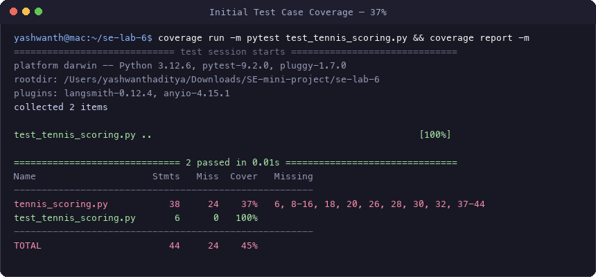

# Lab 6: Code and Branch Coverage Analysis

## Overview
This repository contains the software engineering lab project on **Code Coverage and Branch Coverage Analysis** applied to the `tennis_scoring` module. The objective is to understand the fundamental distinction between line coverage and branch coverage, use Python's `coverage` and `pytest` tools to measure coverage, identify untested decision paths, and design test suites to achieve greater than 90% coverage.

## Project Structure
- `tennis_scoring.py`: The core application module implementing tennis scoring logic across games, sets, and matches.
- `test_tennis_scoring.py`: Pytest test suite for automated test execution.
- `CodeCoverageTest_tennis_scoring.py`: Targeted test suite designed for Code Coverage analysis (achieves 95% line coverage).
- `CodeCoverageTest_tennis_scoring_application.py`: Compatible naming alias for Code Coverage deliverables.
- `screenshots/`: High-resolution terminal execution screenshots of test execution and coverage reports.

---

## Code Under Test: `tennis_scoring.py`
The module implements three key functions:
1. `game_score(a, b)`:
   - Evaluates regular game scores (`0-0`, `15-30`, etc.).
   - Validates non-negative inputs (raises `ValueError`).
   - Handles deuce scenarios (`3-3`, `4-4`, etc.).
   - Resolves advantage states (`advantage A`, `advantage B`).
   - Determines game victories (`game A`, `game B`).
2. `set_winner(a, b)`:
   - Determines standard set victory when a player wins $\ge 6$ games with a $\ge 2$ game margin.
   - Evaluates tiebreak set victories (`7-6` for A, `6-7` for B).
   - Returns `None` when the set is ongoing or tied.
3. `match_status(sets_a, sets_b, best_of)`:
   - Determines match winner when either player wins the majority of sets (`needed = best_of // 2 + 1`).
   - Identifies deciding set scenarios (`decider`).
   - Returns `"in progress"` otherwise.

---

## Setup & Dependencies
Install the required testing and coverage packages:
```bash
pip install coverage pytest
```

---

## 1. Initial Test Case Coverage Analysis
The starter test suite contained two basic test cases:
```python
def test_game_start():
    assert game_score(0, 0) == "0-0"

def test_set_undecided():
    assert set_winner(3, 2) is None
```

### Initial Metrics:
- **Line Coverage**: **37%** (24 of 38 statements unexecuted: lines 6, 8–16, 18, 20, 26, 28, 30, 32, 37–44)
- **Branch Coverage**: **32%** (Missing branches: 8 partial branches, 24 missed statements)



---

## 2. Code Coverage Implementation (>90% Coverage)
To satisfy the first milestone of achieving $\ge 90\%$ code coverage, comprehensive test cases were designed in `CodeCoverageTest_tennis_scoring.py` covering standard match flows, regular scoring, deuce/advantage dynamics, and match completions.

### Commands to Run:
```bash
# Run tests and gather line coverage
coverage run -m pytest CodeCoverageTest_tennis_scoring.py

# View line coverage report
coverage report -m

# Run tests and gather branch coverage
coverage run --branch -m pytest CodeCoverageTest_tennis_scoring.py

# View branch coverage report
coverage report -m
```

### Code Coverage Results:
- **Total Statements in `tennis_scoring.py`**: 38
- **Statements Executed**: 36
- **Statements Missed**: 2 (Lines 30, 32)
- **Line Coverage Achieved**: **95%** (Exceeds the 90% requirement)
- **Branch Coverage**: **94%** (30 branches total, 2 branch parts missing: lines 30, 32)

### Terminal Output Screenshot:


### Untested Paths Identified for Branch Coverage:
While line coverage reached 95%, running with `--branch` highlights untested logical paths:
1. **Tiebreak Set Victories**: Lines 30 (`a == 7 and b == 6`) and 32 (`b == 7 and a == 6`) in `set_winner()` were not exercised.
2. **Compound Boolean Branches**: In `if a < 0 or b < 0:`, only the first operand (`a < 0`) was tested, leaving `b < 0` untested.
3. **Deciding Set Edge Conditions**: Match status decision logic under varied best-of parameters.

These decision branches will be fully resolved in the next milestone.
